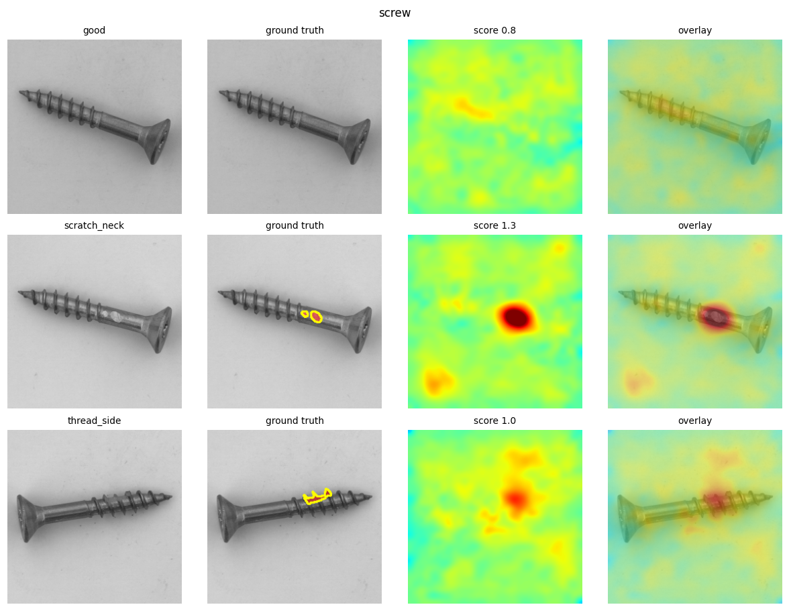
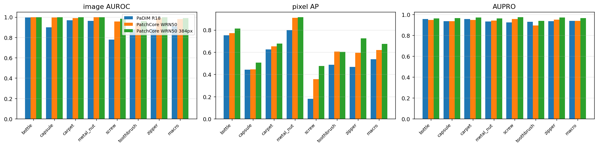
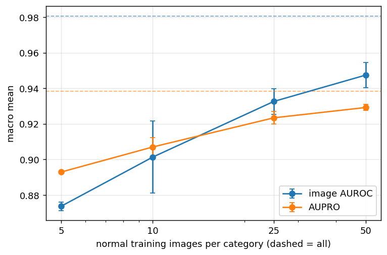
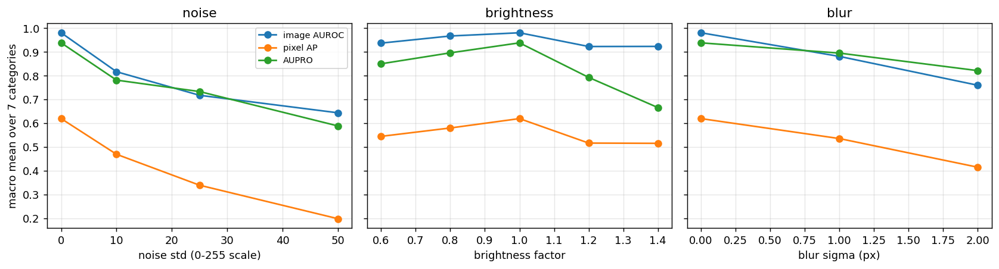
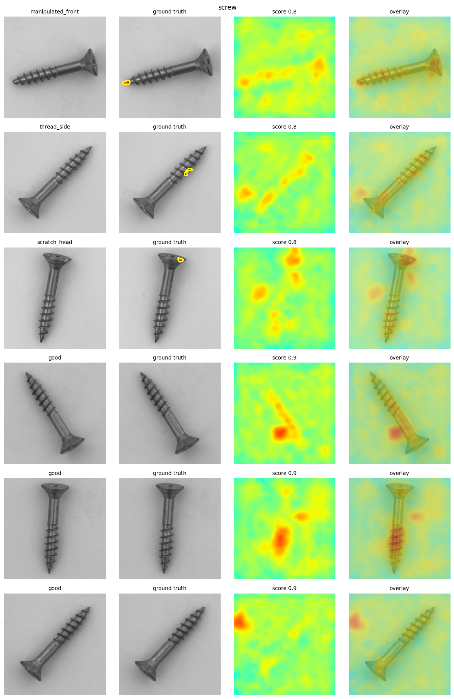

# Industrial Visual Anomaly Detection

Detect and localize defects in industrial product images using a model trained **only on normal images**.
PatchCore and a PaDiM baseline, evaluated on 7 categories of the MVTec AD dataset, with a live demo.

**Live demo:** https://industrial-anomaly-detection-te.streamlit.app/
(pick a product, use a sample or upload your own image, get a verdict, an anomaly score and a heatmap).
The app runs on a free tier: after a period without visitors it sleeps, and the first request afterwards takes a few
minutes while the models are downloaded. Later requests take a few seconds.



*Seeded random examples (not cherry-picked): normal image, then two defect types. Columns: image, ground truth, anomaly heatmap, overlay.*

## Headline results

Measured on the MVTec AD **test** split of 7 categories (bottle, capsule, carpet, metal_nut, screw, toothbrush,
zipper), macro-averaged over categories, single run (seed 0):

| Model | Image AUROC | Image AP | Pixel AP | AUPRO |
|---|---:|---:|---:|---:|
| PaDiM (ResNet-18), 256 px | 0.910 | 0.964 | 0.536 | 0.938 |
| PatchCore (WideResNet-50), 256 px | 0.981 | 0.993 | 0.619 | 0.938 |
| PatchCore (WideResNet-50), 384 px | 0.991 | 0.997 | 0.673 | 0.963 |

These numbers use this project's own protocol (full image resized to a square, no centre crop, own AUPRO
implementation, simplified PatchCore, 7 of 15 categories). **They are not comparable to numbers published in papers.**

## The task

- **Anomaly detection:** is the product image normal or defective?
- **Anomaly localization:** which pixels are defective? The model outputs a pixel-level anomaly heatmap.

Terminology: this is **unsupervised / one-class** anomaly detection. Training uses normal images only and never sees
a defect or a ground-truth mask; "anomalous" means "does not look like normal". It is not supervised defect
classification, which would need labelled defect examples. Ground-truth masks are used only to evaluate localization.

## Method

Both models use a frozen ImageNet-pretrained ResNet as a feature extractor. "Training" means storing statistics of
normal features: there is no gradient descent. One model is fitted per product category.

**PaDiM (baseline)**, `src/models/padim.py`. ResNet-18 layers 1 to 3 give 448-channel features at each position
(100 randomly chosen channels are kept). For every position a Gaussian (mean and covariance) is fitted over the normal
training images. A test patch is scored by its Mahalanobis distance to the Gaussian of its own position. It is a real
baseline because it is a different kind of model (parametric, position-specific) and is cheap.

**PatchCore (main model)**, `src/models/patchcore.py`.
1. WideResNet-50 layers 2 and 3 give patch features (32x32 patches per 256 px image). Each is averaged with its 3x3 neighbours.
2. Layer 3 is upsampled and concatenated with layer 2 (1,536 channels), then reduced to 1,024 by channel-wise average pooling.
3. Patches from all normal training images form a memory bank. A **greedy coreset** (k-center on a random 128-dim projection) keeps the 10% of patches that best cover the normal appearance.
4. A test patch's score is its L2 distance to the nearest memory patch. The patch scores are bilinearly upsampled and blurred (Gaussian, sigma 4) into the anomaly map. The **image score is the maximum of the map**.

Differences from the reference implementation: one adaptive average pool replaces the two-stage dimension reduction,
and the image score is the plain map maximum. Settings (layers 2+3, 3x3 aggregation, 10% coreset) were fixed in
advance from the paper and were **not tuned on the test set**.

## Data and preprocessing

MVTec AD, 7 categories. 1,548 normal training images; 800 test images (178 normal, 622 defective); 30 defect types.
All 622 defective images have a matching mask. Details and figures: `docs/dataset_audit/`, notebook `01`.

- Training uses only the normal `train/good` images (enforced in code). Masks are used only for evaluation.
- The whole image is resized to 256x256 (`INTER_AREA`), no crop, so no ground-truth pixels are discarded.
  Grayscale categories (screw, zipper) are replicated to 3 channels. ImageNet normalization. No augmentation
  (a flipped metal_nut is itself a defect class).
- Masks are resized with `INTER_AREA` and thresholded at 0.5. Metrics are computed at the resized resolution.
- Defects are small: screw defects have a median area of about 0.25 to 0.5% of the image, which is why resolution is tested below.

## Evaluation protocol

- **Image-level:** AUROC and Average Precision (AP) of the image score.
- **Pixel-level:** AUROC and AP over **all pixels of all test images** (normal images contribute all-zero masks), and **AUPRO** (per-region overlap, integrated up to FPR 0.3, normalised to [0, 1]).
- **Aggregation:** the headline number is the **macro mean** of the seven per-category metrics. Pooling pixels or images across categories would let large categories dominate and mix score scales that are not comparable.
- Pixel AUROC is almost saturated for every model here (0.978 to 0.992) because defects cover a tiny fraction of pixels. **Judge localization by pixel AP and AUPRO.**
- Thresholded metrics (precision, recall, F1) use thresholds computed from normal training images only, never from test data (see below).

## Results

All tables come from the saved experiment outputs in `docs/results/` (`experiments/*.csv`).

### PaDiM vs PatchCore, per category (256 px)

| Category | Image AUROC PaDiM | Image AUROC PatchCore | Pixel AP PaDiM | Pixel AP PatchCore | AUPRO PaDiM | AUPRO PatchCore |
|---|---:|---:|---:|---:|---:|---:|
| bottle | 0.996 | 1.000 | 0.752 | 0.772 | 0.955 | 0.946 |
| capsule | 0.900 | 0.994 | 0.443 | 0.446 | 0.936 | 0.935 |
| carpet | 0.967 | 0.988 | 0.625 | 0.653 | 0.957 | 0.948 |
| metal_nut | 0.963 | 0.999 | 0.799 | 0.909 | 0.932 | 0.941 |
| screw | 0.780 | 0.956 | 0.181 | 0.357 | 0.923 | 0.954 |
| toothbrush | 0.878 | 0.939 | 0.486 | 0.604 | 0.928 | 0.894 |
| zipper | 0.884 | 0.988 | 0.468 | 0.594 | 0.935 | 0.951 |
| **macro** | **0.910** | **0.981** | **0.536** | **0.619** | **0.938** | **0.938** |

- PatchCore detects defects clearly better (largest gains: screw, capsule, zipper). On localization the two are tied
  on AUPRO at 256 px (PaDiM is better on bottle, carpet and toothbrush), while PatchCore has the higher pixel AP.
- PaDiM is weakest on screw, whose orientation varies. That is consistent with PaDiM's assumption that a position
  looks the same across images, but it was not tested directly.
- Test sets are small (toothbrush has 12 normal test images), so differences below about 0.01 AUROC should not be over-read.
- Per-defect-type AUROC: `docs/results/per_defect_type_auroc.csv`. The hardest types for PatchCore are screw
  `thread_side` (0.919) and `manipulated_front` (0.922) and the single toothbrush defect type (0.939).



### Resolution: 256 px vs 384 px (PatchCore)

| Category | Image AUROC 256 | 384 | Pixel AP 256 | 384 | AUPRO 256 | 384 |
|---|---:|---:|---:|---:|---:|---:|
| bottle | 1.000 | 1.000 | 0.772 | 0.812 | 0.946 | 0.963 |
| capsule | 0.994 | 0.998 | 0.446 | 0.506 | 0.935 | 0.964 |
| carpet | 0.988 | 1.000 | 0.653 | 0.677 | 0.948 | 0.971 |
| metal_nut | 0.999 | 1.000 | 0.909 | 0.916 | 0.941 | 0.962 |
| screw | 0.956 | 0.983 | 0.357 | 0.475 | 0.954 | 0.975 |
| toothbrush | 0.939 | 0.958 | 0.604 | 0.602 | 0.894 | 0.937 |
| zipper | 0.988 | 0.998 | 0.594 | 0.726 | 0.951 | 0.971 |
| **macro** | **0.981** | **0.991** | **0.619** | **0.673** | **0.938** | **0.963** |

The higher resolution improves or matches image AUROC and AUPRO in every category, most on screw (pixel AP is unchanged for toothbrush). The cost: fit time per category
(mean over the 7 categories, T4) 25 s to 87 s, and mean peak GPU memory 2.0 GB to 4.4 GB. This is a sensitivity
analysis, not model selection: both resolutions are reported, and the demo uses 256 px.

### Coreset size and backbone (PatchCore, 256 px, macro)

| Variant | Image AUROC | Pixel AP | AUPRO | Fit time / category | Peak GPU |
|---|---:|---:|---:|---:|---:|
| WRN50, 10% coreset (main) | 0.981 | 0.619 | 0.938 | 25 s | 2.0 GB |
| WRN50, 1% coreset | 0.978 | 0.616 | 0.932 | 10 s | 2.0 GB |
| ResNet-18, 10% coreset | 0.976 | 0.582 | 0.942 | 26 s | 1.4 GB |

A 10x smaller memory bank costs 0.003 image AUROC. PatchCore with ResNet-18 (0.976) is far closer to PatchCore with
WideResNet-50 (0.981) than to PaDiM (0.910), so most of the PaDiM gap comes from the method rather than the backbone.
The comparison is not perfectly controlled: PaDiM uses layers 1 to 3 and PatchCore layers 2 and 3.

### How many normal images are needed? (PatchCore, mean ± std over 3 seeds)

| Normal training images per category | Image AUROC | Pixel AP | AUPRO |
|---:|---:|---:|---:|
| 5 | 0.874 ± 0.002 | 0.555 ± 0.012 | 0.893 ± 0.001 |
| 10 | 0.901 ± 0.020 | 0.568 ± 0.004 | 0.907 ± 0.005 |
| 25 | 0.933 ± 0.007 | 0.583 ± 0.007 | 0.923 ± 0.004 |
| 50 | 0.947 ± 0.007 | 0.596 ± 0.007 | 0.929 ± 0.002 |
| all (209 to 320; toothbrush 60) | 0.981 (1 run) | 0.619 | 0.938 |

The std reflects which normal images were sampled (the test set is fixed). Toothbrush has only 60 normal images,
so 50 is almost its full set.



### Speed and memory

Inference only, measured on **bottle at 256 px** (images preloaded, warm-up excluded). PatchCore's search cost grows
with the memory-bank size, so other categories can differ.

| Model | Device | Batch | Time per image | Peak memory |
|---|---|---:|---:|---:|
| PaDiM (R18) | T4 GPU | 1 / 8 | 3.7 ms / 1.8 ms | 0.20 / 0.31 GB |
| PatchCore (WRN50) | T4 GPU | 1 / 8 | 24.3 ms / 23.3 ms | 0.38 / 1.63 GB |
| PatchCore (WRN50), app code path | Colab CPU, 1 thread | 1 | 1.4 to 2.9 s | not measured |

The CPU figure is the range of repeat calls over six sample images (bottle, screw, carpet; normal and defective), not a benchmark.

### Robustness (test-time corruptions, PatchCore 256 px, macro)

The saved models were evaluated on corrupted test images (corruption applied after resizing to 256 px). The models
were never trained on corrupted images.

| Corruption | Image AUROC | Pixel AP | AUPRO |
|---|---:|---:|---:|
| clean | 0.981 | 0.619 | 0.938 |
| noise, std 10 | 0.817 | 0.469 | 0.781 |
| noise, std 25 | 0.717 | 0.339 | 0.733 |
| noise, std 50 | 0.644 | 0.198 | 0.588 |
| brightness x0.6 | 0.937 | 0.545 | 0.850 |
| brightness x0.8 | 0.967 | 0.580 | 0.896 |
| brightness x1.2 | 0.923 | 0.516 | 0.793 |
| brightness x1.4 | 0.923 | 0.515 | 0.666 |
| blur, sigma 1 | 0.881 | 0.535 | 0.895 |
| blur, sigma 2 | 0.760 | 0.415 | 0.821 |

The model is **sensitive to noise and blur**, even mild noise (std 10 on a 0 to 255 scale) cuts macro image AUROC from
0.98 to 0.82. Brightness effects depend on the category: carpet and metal_nut barely change, while capsule and screw
collapse at higher brightness (screw AUPRO is 0.000 at x1.4). I did not verify why. **Confound:** screw and zipper are
grayscale images replicated to 3 channels, and the noise is added independently per channel, so for these two
categories part of the damage may come from colour noise rather than noise as such. A grayscale-consistent rerun
was not done. Screw image AUROC falls below 0.5 under some corruptions (0.298 at noise 25), meaning the ranking
inverts; the cause is unknown.



### Decision thresholds and an honest calibration story

AUROC and AP need no threshold, but a normal/defective verdict does. A threshold must come from **normal data only**
(the model never sees defects). All rules below were fixed before looking at the test results they were evaluated on,
except that v2 was introduced *after* seeing v1's test results (documented here as a revision).

- **v1: single 10% hold-out.** Fit on 90% of the normal training images, score the other 10% (6 to 32 images per category), threshold = maximum held-out score. Result: unstable. Screw recall was 0.50 (one outlier among 32 held-out images set the threshold too high) and carpet FPR was 0.46 (test normals scored higher than held-out normals).
- **v2: 5-fold out-of-fold calibration.** Every normal training image is scored by a model that never saw it (60 to 320 scores per category). Primary rule fixed before running: 99th percentile of the out-of-fold scores.

Macro results on the test set (image-level, predicted defective if score > threshold):

| Calibration and rule | Recall | False-positive rate | F1 |
|---|---:|---:|---:|
| v1, max of 10% hold-out | 0.912 | 0.157 | 0.920 |
| v1, mean + 3 std | 0.901 | 0.119 | 0.922 |
| v2, p99 of out-of-fold scores (**demo default**) | 0.870 | 0.080 | 0.906 |
| v2, mean + 3 std | 0.883 | 0.079 | 0.917 |
| v2, max of out-of-fold scores | 0.793 | 0.053 | 0.844 |
| oracle: best threshold chosen on the test set (upper bound, not a result) | | | 0.977 |

Cross-validated calibration **made thresholds more stable and about halved the false-alarm rate** (0.157 to 0.080), at
some cost in recall. **It did not improve F1.** Per category with the v2 p99 threshold: bottle, metal_nut and zipper work
well (F1 0.99 to 1.00); carpet still raises false alarms (FPR 0.29, down from 0.46); screw and capsule miss many
defects (recall 0.59 and 0.57; capsule was 0.89 under v1). The oracle F1 is 0.94 to 1.00 for every category, so the
*ranking* of images is good and the loss comes from choosing a threshold without seeing defects. The test set is 78%
defective, so precision is flattering; read recall and FPR with it. Full tables: `docs/results/thresholded_metrics*.csv`.

In carpet and toothbrush the test normals scored higher than the held-out training normals (carpet: 46% of test normals
were above the held-out maximum). I could not establish whether this is a train/test difference in the dataset or small-sample
noise. For this reason the demo has a **sensitivity slider** (threshold scale) next to the default per-category threshold.

### Error analysis

- Scores of normal and defective images overlap in the hard categories: for screw, the three highest-scoring normal images (0.90 to 0.93) scored above the three lowest-scoring defective ones (0.79 to 0.83). Toothbrush and capsule show the same pattern.
- False alarms were scattered over the image, not concentrated at one spot, and anomaly-map peaks of normal images almost never fall in the outer 5% border (0.00 in six categories, 0.08 in toothbrush), so there is no sign of an edge artefact. Scattered false alarms suggest ordinary within-normal variation not covered by the training set; this is a hypothesis.



*Rows 1 to 3: lowest-scoring defective images (likely misses). Rows 4 to 6: highest-scoring normal images (likely false alarms).*
More: `docs/figures/` (gallery for every category, error figures for screw, toothbrush and capsule).

## Limitations

- **One model per category, and you must choose the category.** The system does not recognise the product. An unrelated image will score as anomalous.
- **Sensitive to imaging conditions:** noise, blur and strong brightness changes degrade it substantially (see Robustness). It is meant for consistent industrial imaging, like the dataset.
- **Thresholds from normal data are fragile** for some categories (screw, capsule miss defects; carpet false alarms), and the cause of the train/test normal shift in carpet and toothbrush is not established.
- **Small test sets** (e.g. 12 normal toothbrush images) and **single-seed** main results (only the few-shot runs use 3 seeds); no significance tests.
- **Not a benchmark replication:** 7 of 15 MVTec categories, no centre crop, own AUPRO and PatchCore implementation. Do not compare with published numbers.
- Metrics are computed at 256 px (masks resized); the image score is the map maximum.
- The live demo is on free hosting: it sleeps when idle and the first request is slow.

## Repository layout

```text
app/           Streamlit app (streamlit_app.py), thresholds.json, 14 sample images
configs/       experiment configs (YAML)
scripts/       run_experiment.py, run_robustness.py, calibrate_thresholds.py, calibrate_cv.py
src/           data/ (index, dataset, corruptions) · models/ (PaDiM, PatchCore) · evaluation/ · visualization/ · inference/
notebooks/     00 environment · 01 dataset inspection · 02 experiments (recipe) · 03 analysis and figures
docs/          figures, dataset audit, and result tables (CSV/JSON) used in this README
```

The dataset and the model files are not in the repository. The models (about 650 MB in total) are published as assets of the
GitHub release `models-v1`, from which the app downloads them.

## Reproducing the results

The experiments ran on Google Colab (Tesla T4, Python 3.13, PyTorch 2.14.1). The notebooks follow that workflow:
code from GitHub, dataset on Drive, results written to Drive.

1. Download MVTec AD from the [official page](https://www.mvtec.com/company/research/datasets/mvtec-ad) (accepting its license) and keep the 7 category folders.
2. Run `notebooks/00_environment_setup.ipynb` once (copies the dataset, builds an archive), then `01`, `02` and `03` in order. `02` needs a GPU. Notebook outputs are cleared; the results are in `docs/results/`.
3. Or run a single experiment from the command line:

```bash
pip install -r requirements.txt     # pins mirror the Colab environment; on Colab do not reinstall torch
python scripts/run_experiment.py --config configs/patchcore_wrn50_256.yaml \
    --data-root datasets/mvtec_anomaly_detection --out-dir experiments
# overrides need a new name, e.g.:
python scripts/run_experiment.py --config configs/patchcore_wrn50_256.yaml \
    --data-root datasets/mvtec_anomaly_detection --out-dir experiments \
    --set name=patchcore_wrn50_384 image_size=384 batch_size=8
```

Runs write per-category metrics, saved anomaly maps and the config actually used to `experiments/<name>/`, and skip
categories that already have results. Seeds are fixed: re-running the main configuration with the same seed
reproduced the earlier run's metrics exactly (4 decimals). I ran the experiments on Colab only; a local GPU run was not tested.

Run the app locally (CPU):

```bash
pip install -r app/requirements.txt
streamlit run app/streamlit_app.py     # downloads the models from the GitHub release on first use
```

## License and attribution

- **Code:** MIT (`LICENSE`).
- **Dataset:** MVTec AD is licensed under **CC BY-NC-SA 4.0** (non-commercial use only). The sample images in `app/samples/`
  are MVTec AD test images, and the published models are derived from MVTec AD training images, so they carry the same
  non-commercial terms. This is a portfolio project.

## References

- P. Bergmann, M. Fauser, D. Sattlegger, C. Steger. *MVTec AD: A Comprehensive Real-World Dataset for Unsupervised Anomaly Detection.* CVPR 2019.
- K. Roth, L. Pemula, J. Zepeda, B. Schölkopf, T. Brox, P. Gehler. *Towards Total Recall in Industrial Anomaly Detection (PatchCore).* CVPR 2022.
- T. Defard, A. Setkov, A. Loesch, R. Audigier. *PaDiM: a Patch Distribution Modeling Framework for Anomaly Detection and Localization.* ICPR 2020 Workshops.
